# PR Risk Scout Agent

> **A second pair of eyes for pull requests.** Read the diff, surface changes worth a closer look, show the exact evidence, and leave the decision with the developer.

**PR RISK SCOUT / FIELD NOTES 001**

*設計 · 検証 · 安全* — Design · Verification · Safety

---

## Start here

If you are new to programming, start with **[The project in plain English](#the-project-in-plain-english)**. If you already use GitHub, jump to **[Run your first scan](#run-your-first-scan)**. If you want to inspect the evidence behind the benchmark, open **[The real-repository case study](benchmarks/results/real_pr_benchmark.md)**.

- [Step-by-step beginner walkthrough](docs/STEP_BY_STEP.md)
- [Architecture explained simply](docs/ARCHITECTURE.md)
- [Benchmark method and limitations](docs/BENCHMARK_METHOD.md)
- [Threat model](docs/THREAT_MODEL.md)
- [Operating guide](docs/OPERATING_GUIDE.md)
- [FAQ](docs/FAQ.md)
- [Benchmark JSON](benchmarks/results/real_pr_benchmark.json)

**The most important sentence in this repository:** PR Risk Scout suggests where to look. It does not approve, reject, comment on, label, assign, or merge pull requests. A person makes the decision.

## The project in plain English

Imagine that a developer opens a pull request. The pull request contains 40 changed files. Most changes are ordinary. A few lines may deserve extra attention: an access check has been removed, a database column is being dropped, a certificate verification setting has changed, or a third-party action in the build workflow has been updated.

A reviewer has to read the whole proposal and understand what those changes mean. That can take time, especially when the codebase is unfamiliar or the pull request is large.

PR Risk Scout is a small tool that reads the change description — the **Git diff** — and highlights some patterns that deserve a closer look. It reports the file, line, changed text, reason for the signal, and a question the reviewer can investigate.

Think of it as a desk lamp, not an autopilot. A desk lamp helps you see a corner of the page. It does not read the page for you, decide what is correct, or sign the document on your behalf.

### What it does

- Fetches a pull-request diff from GitHub using read-only HTTP requests, or reads a diff saved on your computer.
- Parses added and removed lines while preserving file paths and line numbers.
- Checks selected patterns involving permissions, migrations, TLS, secrets, dangerous execution, dependencies, CI workflows, runtime versions, caches, schemas, timing, type analysis, syntax, tests, interfaces, errors, and serialization.
- Creates a structured JSON report for other programs.
- Creates a Markdown report that a human can read.
- Includes a real-public-PR case study with pinned revisions and transparent limitations.

### What it does not do

- It does not prove that a pull request is safe.
- It does not prove that a finding is a bug or vulnerability.
- It does not replace a security review, code review, test suite, or static-analysis platform.
- It does not execute code from the pull request.
- It does not write to GitHub.
- It does not automatically approve, reject, comment on, assign, label, or merge a pull request.
- It does not use an LLM in the core analysis path today. The first version is deliberately rule-based so its behaviour can be inspected and tested.

## Quick start

### Requirements

- Python 3.10 or newer.
- Git, if you want to download the project with Git.
- An internet connection for GitHub pull-request mode.
- A GitHub token is optional for public repositories. If you use one, give it read-only access to only the repositories you need.

### Windows PowerShell

~~~powershell
git clone https://github.com/yerageracharan/pr-risk-scout-agent.git
cd pr-risk-scout-agent

python -m venv .venv
.venv\Scripts\Activate.ps1

python -m pip install --upgrade pip
pip install -r requirements.txt pytest
~~~

If PowerShell refuses to activate the environment, you can run the Python executable inside it directly:

~~~powershell
.venv\Scripts\python.exe -m pip install -r requirements.txt pytest
~~~

### macOS or Linux

~~~bash
git clone https://github.com/yerageracharan/pr-risk-scout-agent.git
cd pr-risk-scout-agent

python3 -m venv .venv
source .venv/bin/activate

python -m pip install --upgrade pip
pip install -r requirements.txt pytest
~~~

### Check that the package imports

~~~bash
python -c "import pr_risk_scout; print(pr_risk_scout.__version__)"
~~~

You should see the package version. That confirms Python can find the package from the project root. It does not yet mean that GitHub access or every detector is working; those are separate checks.

## Run your first scan

### Scan the sample diff

The repository contains `examples/sample.diff`. It is a deliberately small teaching example. It includes a change in an authentication-related file, a database migration, and a dependency manifest update.

~~~bash
python -m pr_risk_scout --diff examples/sample.diff --format both --out reports/sample
~~~

Two files should be created:

- `reports/sample.json` — structured data.
- `reports/sample.md` — a readable report.

Open the Markdown file first. Find a result, read the file and line reference, then open the sample diff and confirm that the evidence really appears there. This is the fastest way to understand the relationship between source text and a finding.

### Scan a public pull request

For example, scan a public Flask pull request:

~~~bash
python -m pr_risk_scout --repo pallets/flask --pr 6168 --format both --out reports/flask-6168
~~~

The command retrieves the pull-request diff and uses the same parser and rule engine as local mode. It makes a GET request. It does not post a review or change the remote repository.

### Scan a private pull request

Create a fine-grained GitHub token with read-only access to the repository's contents and pull requests. Store it as an environment variable.

Windows PowerShell:

~~~powershell
$env:GITHUB_TOKEN = "YOUR_READ_ONLY_TOKEN"
python -m pr_risk_scout --repo owner/repository --pr 123 --format both --out reports/pr-123
~~~

macOS or Linux:

~~~bash
export GITHUB_TOKEN="YOUR_READ_ONLY_TOKEN"
python -m pr_risk_scout --repo owner/repository --pr 123 --format both --out reports/pr-123
~~~

Do not put the token in the Python source, the README, a screenshot, a report, or a Git commit. The token should be scoped to the repositories you need. Revoke it if it is exposed.

## Visual field guide

The 40 original SVG diagrams use a Japanese technical-editorial visual language: warm paper, dark ink, teal, vermilion, and ochre. Each diagram is a separate SVG file, so it stays sharp at any zoom level and can be edited later. Small Japanese labels such as 設計 (design), 検証 (verification), and 安全 (safety) are visual section marks; the technical explanations remain in English.

### 01 · System architecture

Follows a pull request from GitHub through parsing and rule evaluation to a local evidence report. The diagram is a map for learning the topic, not a complete formal specification. Use it to orient yourself, then read the related implementation and tests.

### 02 · PR workflow

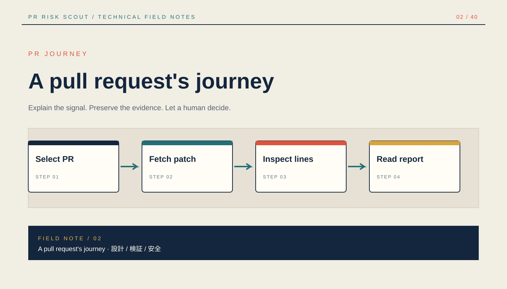

Shows the four-stage workflow: choose a PR, fetch a patch, inspect changes, and read the report. The diagram is a map for learning the topic, not a complete formal specification. Use it to orient yourself, then read the related implementation and tests.

### 03 · Diff anatomy

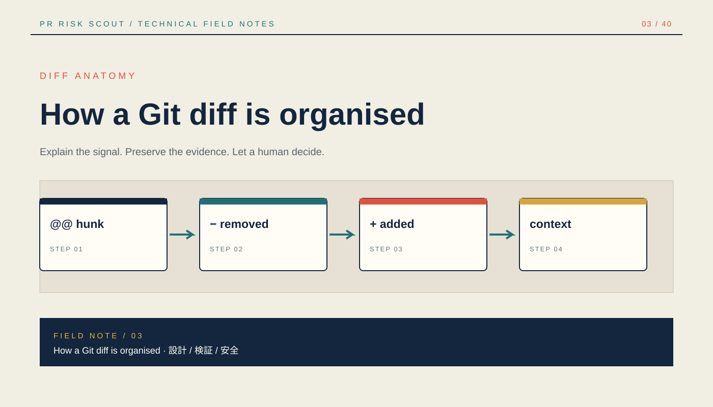

Explains hunk headers, added lines, removed lines, and context lines using a simplified patch. The diagram is a map for learning the topic, not a complete formal specification. Use it to orient yourself, then read the related implementation and tests.

### 04 · Parser state

Shows how file headers and hunk counters let the parser preserve exact changed-line positions. The diagram is a map for learning the topic, not a complete formal specification. Use it to orient yourself, then read the related implementation and tests.

### 05 · Line directions

Contrasts additions and deletions and explains why both should be represented in evidence. The diagram is a map for learning the topic, not a complete formal specification. Use it to orient yourself, then read the related implementation and tests.

### 06 · Rule matching

Shows path context, line-content patterns, policy gates, and the resulting finding. The diagram is a map for learning the topic, not a complete formal specification. Use it to orient yourself, then read the related implementation and tests.

### 07 · Severity ladder

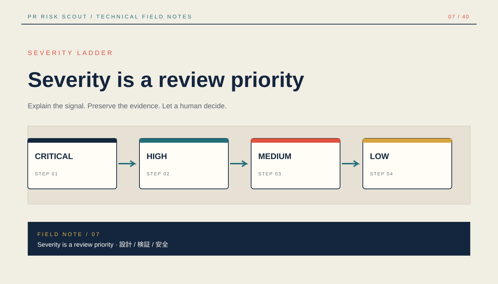

Explains severity as a prioritisation label rather than a probability score. The diagram is a map for learning the topic, not a complete formal specification. Use it to orient yourself, then read the related implementation and tests.

### 08 · Finding shape

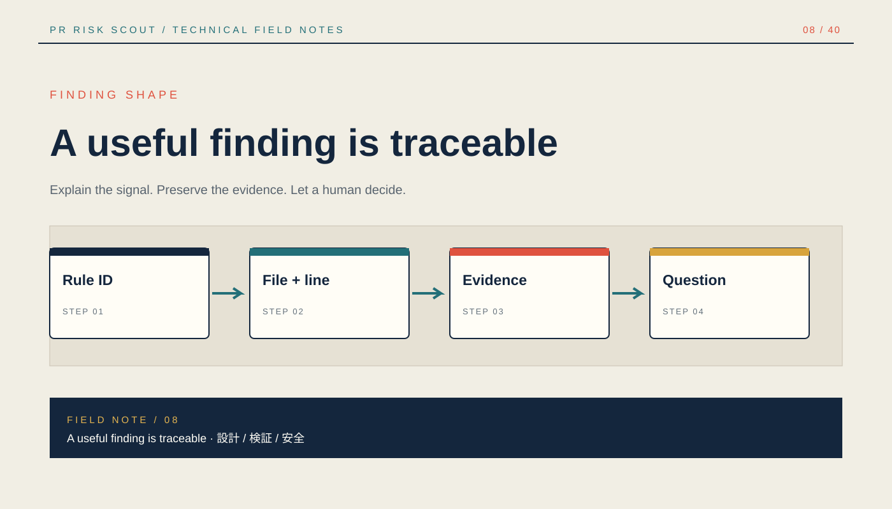

Shows the rule identifier, file and line, evidence, and review question that make a finding traceable. The diagram is a map for learning the topic, not a complete formal specification. Use it to orient yourself, then read the related implementation and tests.

### 09 · Access review

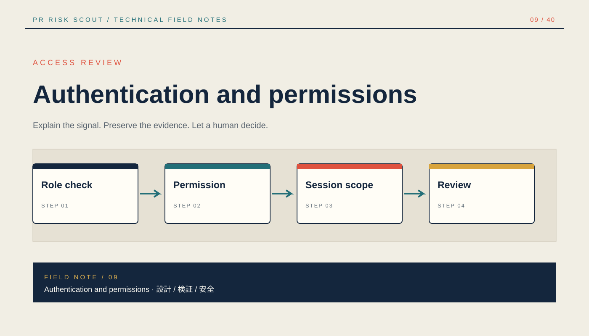

Illustrates the path from a role check to a permission decision and a human review. The diagram is a map for learning the topic, not a complete formal specification. Use it to orient yourself, then read the related implementation and tests.

### 10 · Database migration

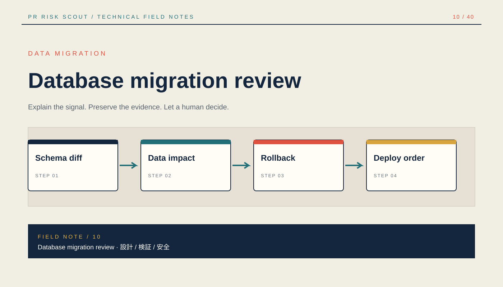

Shows schema differences, data impact, rollback, and deploy-order questions. The diagram is a map for learning the topic, not a complete formal specification. Use it to orient yourself, then read the related implementation and tests.

### 11 · TLS review

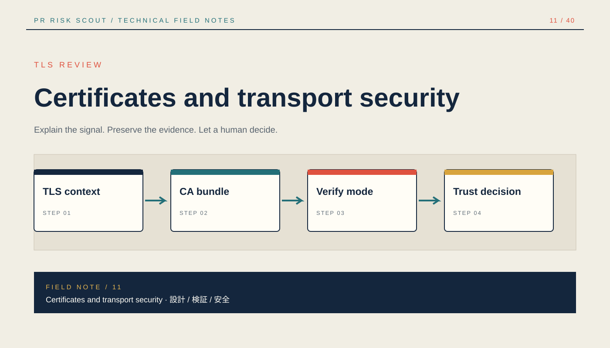

Shows how TLS context, certificate authorities, and verification mode influence trust. The diagram is a map for learning the topic, not a complete formal specification. Use it to orient yourself, then read the related implementation and tests.

### 12 · Secret exposure

Shows the limited pattern-checking path for newly added credential-like lines. The diagram is a map for learning the topic, not a complete formal specification. Use it to orient yourself, then read the related implementation and tests.

### 13 · Execution surface

Shows why an input source, execution sink, parameterisation, and human inspection matter. The diagram is a map for learning the topic, not a complete formal specification. Use it to orient yourself, then read the related implementation and tests.

### 14 · Dependency updates

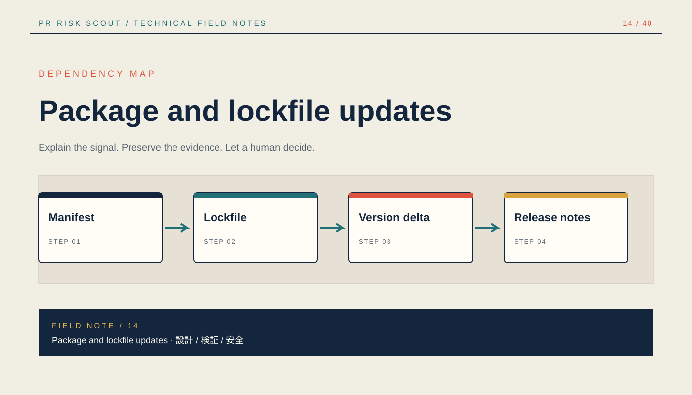

Shows a manifest, lockfile, version delta, and release-note review sequence. The diagram is a map for learning the topic, not a complete formal specification. Use it to orient yourself, then read the related implementation and tests.

### 15 · CI actions

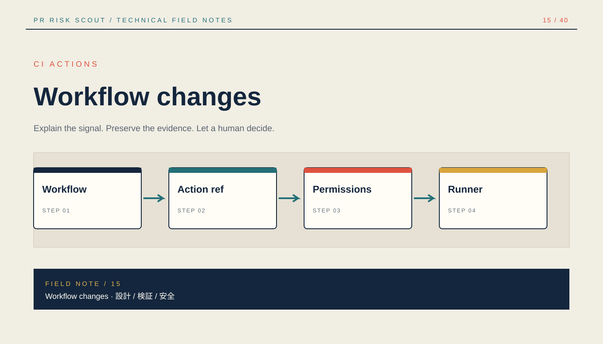

Shows workflow files, action references, permissions, and runners. The diagram is a map for learning the topic, not a complete formal specification. Use it to orient yourself, then read the related implementation and tests.

### 16 · Runtime matrix

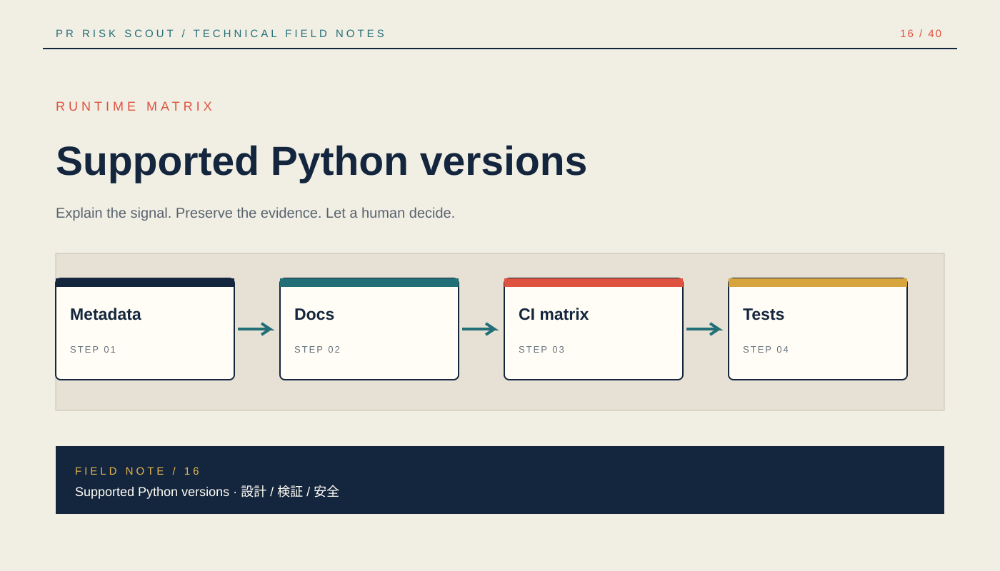

Connects package metadata, documentation, CI, and interpreter tests. The diagram is a map for learning the topic, not a complete formal specification. Use it to orient yourself, then read the related implementation and tests.

### 17 · Cache correctness

Shows cache keys, stored values, copying, and isolation as review points. The diagram is a map for learning the topic, not a complete formal specification. Use it to orient yourself, then read the related implementation and tests.

### 18 · Schema generation

Shows annotations becoming field information, core schema, and validation behaviour. The diagram is a map for learning the topic, not a complete formal specification. Use it to orient yourself, then read the related implementation and tests.

### 19 · Timing model

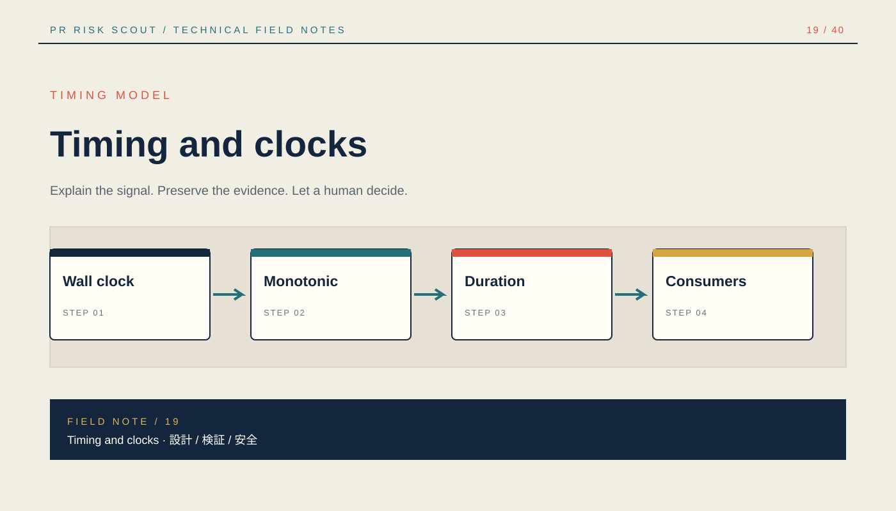

Contrasts wall-clock timestamps with monotonic elapsed-time measurement. The diagram is a map for learning the topic, not a complete formal specification. Use it to orient yourself, then read the related implementation and tests.

### 20 · Type checking

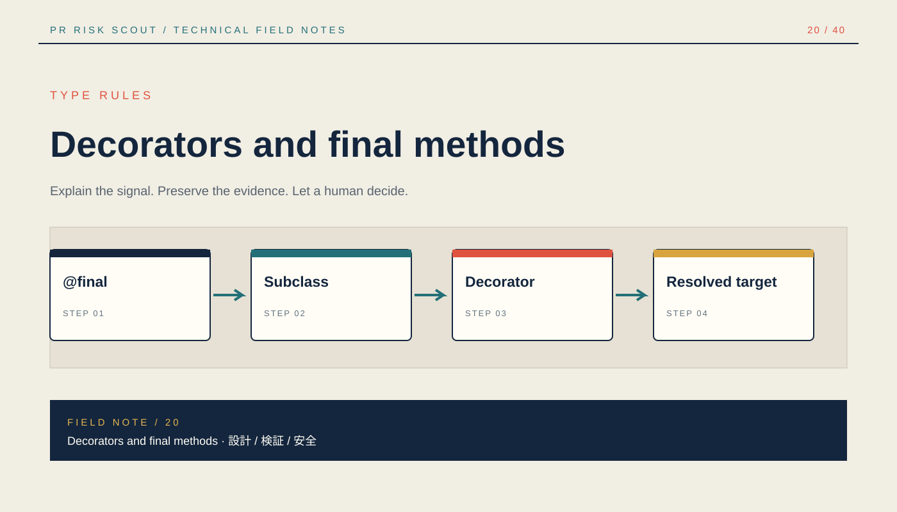

Shows how a final method, subclass, decorator, and resolved binding interact. The diagram is a map for learning the topic, not a complete formal specification. Use it to orient yourself, then read the related implementation and tests.

### 21 · Parser syntax

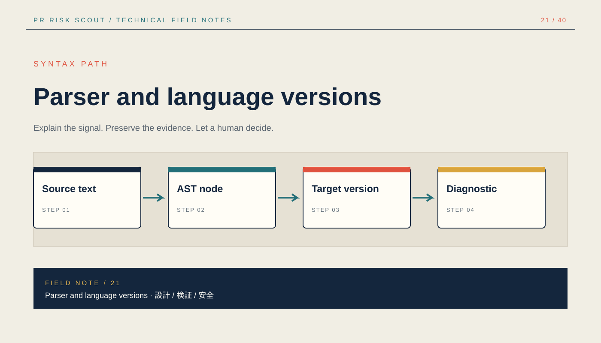

Shows source text becoming syntax nodes and version-specific diagnostics. The diagram is a map for learning the topic, not a complete formal specification. Use it to orient yourself, then read the related implementation and tests.

### 22 · Test surface

Shows test files, fixtures, assertions, and snapshots as review context. The diagram is a map for learning the topic, not a complete formal specification. Use it to orient yourself, then read the related implementation and tests.

### 23 · API contract

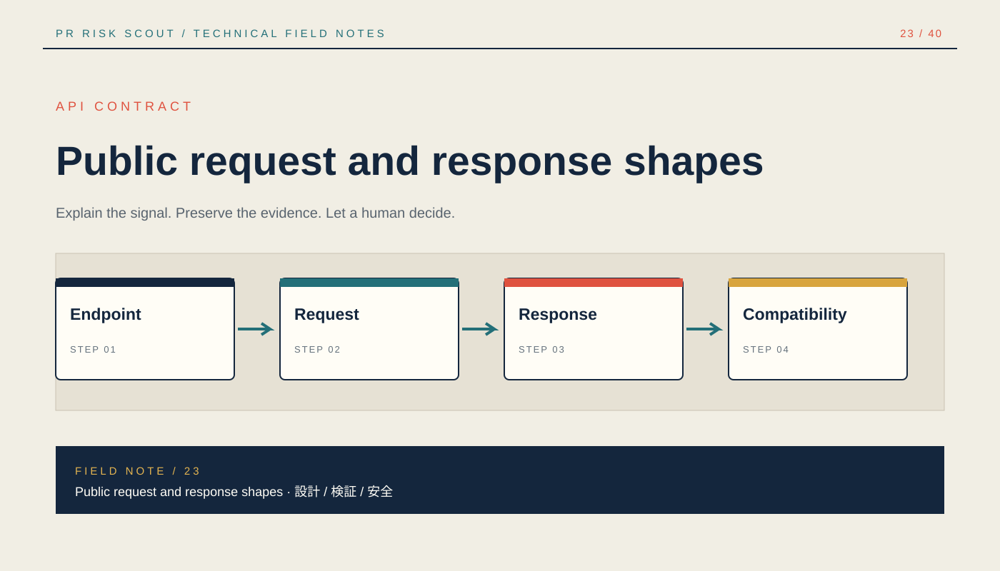

Shows endpoint, request, response, and compatibility as one agreement. The diagram is a map for learning the topic, not a complete formal specification. Use it to orient yourself, then read the related implementation and tests.

### 24 · Error handling

Shows expected and unexpected error paths, fallbacks, and cleanup. The diagram is a map for learning the topic, not a complete formal specification. Use it to orient yourself, then read the related implementation and tests.

### 25 · Serialization

Shows input bytes, decoder, type checks, and result as a trust boundary. The diagram is a map for learning the topic, not a complete formal specification. Use it to orient yourself, then read the related implementation and tests.

### 26 · Evidence trail

Shows the link between a public PR, file path, line number, and changed text. The diagram is a map for learning the topic, not a complete formal specification. Use it to orient yourself, then read the related implementation and tests.

### 27 · CLI loop

Shows command-line arguments, input source, analysis, and generated reports. The diagram is a map for learning the topic, not a complete formal specification. Use it to orient yourself, then read the related implementation and tests.

### 28 · Read only

Makes the GET-only boundary explicit and leaves the final decision with a person. The diagram is a map for learning the topic, not a complete formal specification. Use it to orient yourself, then read the related implementation and tests.

### 29 · Rate limits

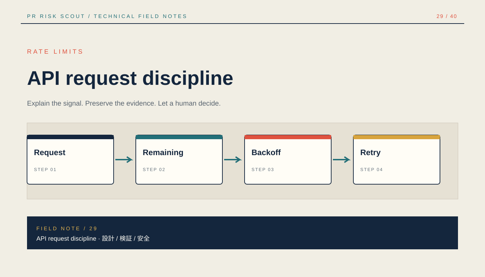

Shows how request budgets, backoff, and retry discipline protect API access. The diagram is a map for learning the topic, not a complete formal specification. Use it to orient yourself, then read the related implementation and tests.

### 30 · Token scopes

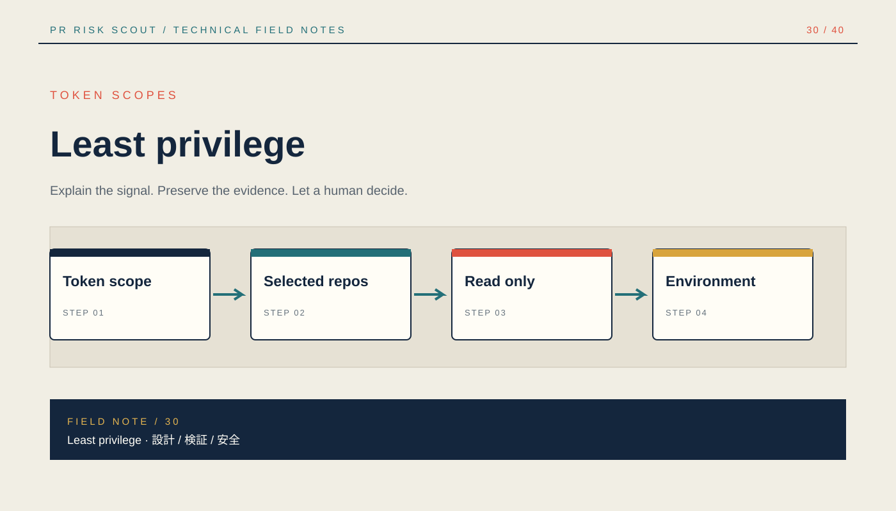

Illustrates a fine-grained token restricted to selected repositories and read-only access. The diagram is a map for learning the topic, not a complete formal specification. Use it to orient yourself, then read the related implementation and tests.

### 31 · Data flow

Shows how data moves from GitHub through parsing and analysis to local files. The diagram is a map for learning the topic, not a complete formal specification. Use it to orient yourself, then read the related implementation and tests.

### 32 · Threat model

Connects assets and trust boundaries with threats and protective controls. The diagram is a map for learning the topic, not a complete formal specification. Use it to orient yourself, then read the related implementation and tests.

### 33 · Human review

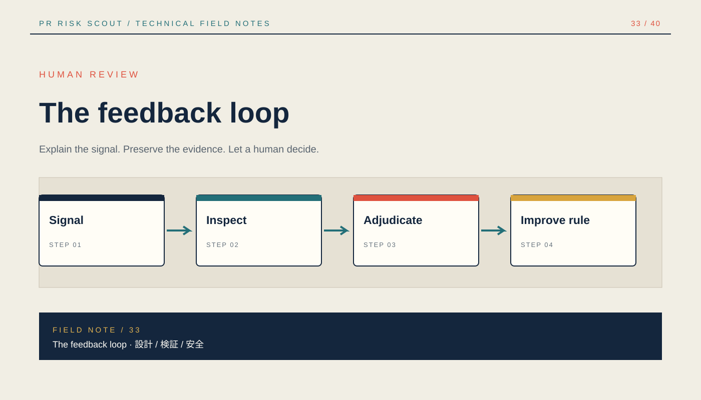

Shows how reviewers inspect signals, adjudicate them, and improve a rule. The diagram is a map for learning the topic, not a complete formal specification. Use it to orient yourself, then read the related implementation and tests.

### 34 · Benchmark plan

Shows selection, SHA pinning, patch retrieval, and comparison with review-focus labels. The diagram is a map for learning the topic, not a complete formal specification. Use it to orient yourself, then read the related implementation and tests.

### 35 · Repository set

Lists the five public projects used in the case study: Flask, Requests, Pydantic, pytest, and Ruff. The diagram is a map for learning the topic, not a complete formal specification. Use it to orient yourself, then read the related implementation and tests.

### 36 · Focus coverage

Displays 18 of 18 focus labels surfaced in the nine selected cases, with the sample caveat. The diagram is a map for learning the topic, not a complete formal specification. Use it to orient yourself, then read the related implementation and tests.

### 37 · Case matrix

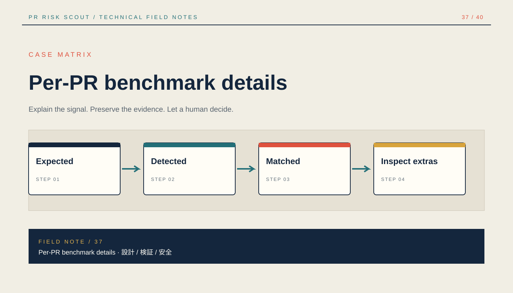

Shows expected labels, detected labels, matched labels, and extra signals. The diagram is a map for learning the topic, not a complete formal specification. Use it to orient yourself, then read the related implementation and tests.

### 38 · Metric caveats

Explains why small-sample focus coverage is not accuracy or precision and recall. The diagram is a map for learning the topic, not a complete formal specification. Use it to orient yourself, then read the related implementation and tests.

### 39 · CI pipeline

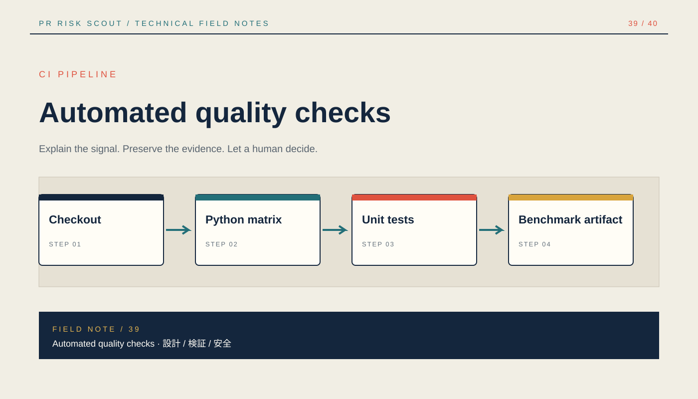

Shows checkout, a Python version matrix, unit tests, and benchmark-artifact output. The diagram is a map for learning the topic, not a complete formal specification. Use it to orient yourself, then read the related implementation and tests.

### 40 · Roadmap

Shows next engineering steps: configurable rules, SARIF, larger samples, and human labels. The diagram is a map for learning the topic, not a complete formal specification. Use it to orient yourself, then read the related implementation and tests.

## The 17 review signals, explained simply

A **rule** is a small, understandable check that looks for a pattern in a changed file or changed line. A rule does not know everything about the program. It can only raise a question. The review signals below are the current rule families.

### 01 · AUTH_PERMISSION_CHANGE — Authentication and access checks

This rule is for changes in code concerned with identity, roles, authorisation, and session access. In plain English, it asks whether the right people still have the right permissions. A removed guard can be as important as a new permission check. The finding is a prompt to inspect the surrounding function, not a claim that an account can definitely be compromised.

### 02 · DATABASE_MIGRATION — Database structure and data movement

A migration can rename, remove, or reshape stored data. The danger may not appear until an older application version or a rollback runs against the changed database. A reviewer should look at backups, data conversion, deployment order, foreign keys, and rollback plans. The rule identifies common migration paths and operations; it cannot predict every production data dependency.

### 03 · TLS_SECURITY_CHANGE — HTTPS trust and certificate verification

TLS is the protocol family used to protect network connections. Certificate verification is how a client checks that it is talking to the server it intended to reach. Changing a TLS context, CA bundle, verification mode, or hostname check deserves attention. The tool cannot prove a configuration is secure; it points to the changed area for a specialist to inspect.

### 04 · SECRET_EXPOSURE — Credentials accidentally added to code

A token or password committed to a repository may be copied, cached, indexed, or included in forks. The first response to a real exposed credential is rotation, not merely deleting the line. This rule recognises a limited set of common token-like patterns on added lines. It does not recognise every vendor's credential format, and it is not a replacement for a dedicated secret scanner.

### 05 · DANGEROUS_EXECUTION — Dynamic or shell execution

Functions such as eval and exec, shell invocation, and dynamically constructed commands need context. The key question is whether untrusted data can reach the execution sink. A fixed command in a trusted build script is different from a command assembled from a web request. This rule only signals certain patterns. It does not perform taint analysis or prove exploitability.

### 06 · DEPENDENCY_CHANGE — Package and action version updates

A dependency can bring new features, bug fixes, breaking changes, transitive packages, licensing terms, and security implications. The rule checks manifests, lockfiles, and action references. It helps a reviewer notice that an update happened. It does not determine whether the new version is safe, maintained, compatible, or free from vulnerabilities. Read the release notes and the package's official advisories.

### 07 · CI_WORKFLOW_CHANGE — Build and automation configuration

CI workflows run code in an automated environment. Their permissions and third-party action references can affect repository secrets and release pipelines. A reviewer should check whether actions are pinned, whether permissions are minimal, and whether the workflow runs on the intended branches and events. The rule points to common workflow files; it does not audit the full trust model of every workflow.

### 08 · RUNTIME_COMPATIBILITY — Supported language and interpreter versions

Changing the minimum supported Python version affects users, package installation, typing, standard-library imports, and CI. The project policy, package metadata, documentation, and test matrix should agree. This rule watches selected metadata and version signals. It does not check every Python syntax feature or prove the application runs on every declared interpreter.

### 09 · CACHE_CORRECTNESS — Cached values and shared state

Caching avoids repeating expensive work, but it can create stale values or shared mutable objects. A reviewer should check cache keys, invalidation, lifetime, copying, and whether one user's data could leak into another user's result. The tool recognises cache-related paths and words. It does not model object identity, thread safety, or the full lifetime of an object.

### 10 · SCHEMA_GENERATION — Model and validation schema changes

Schema generation translates types, annotations, defaults, and configuration into validation behaviour. A small optimisation can affect unions, optional values, custom hooks, forward references, or error reporting. This rule highlights schema-oriented code. It does not prove that every model behaves correctly; tests should cover representative types and edge cases.

### 11 · TIMING_BEHAVIOR — Clocks, durations, and elapsed time

Wall-clock time is useful for displaying a timestamp. Monotonic clocks are safer for measuring elapsed time because wall clocks can jump. Timing changes can affect tests, plugins, metrics, timeouts, and code that mocks the clock. The rule points to timing-related changes but does not run the program under clock changes.

### 12 · TYPE_CHECKING_CHANGE — Static analysis and decorator semantics

Type-checking tools reason about inheritance, overrides, annotations, and decorators. A decorator can replace the function object stored under a method name. A rule can highlight code in a type-analysis area, but the reviewer still needs to understand the type system and its intended semantics. Use fixtures and snapshots to protect diagnostic behaviour.

### 13 · PARSER_SYNTAX_CHANGE — Syntax and language-version handling

A parser or linter may behave differently depending on the target language version. A new syntax rule needs tests for relevant versions and contexts. This finding should lead to inspection of parser state, abstract syntax tree nodes, and diagnostics. The tool does not parse the whole source file as a compiler would.

### 14 · TEST_SURFACE_CHANGE — Tests, fixtures, and snapshots

Test changes are useful review context. Added tests may demonstrate a regression case; deleted tests may remove protection. But tests can also be incomplete, brittle, or unrelated to the implementation. The finding tells a reviewer which test surface changed. It does not equate a larger test count with better quality.

### 15 · PUBLIC_API_CHANGE — Interfaces used by other programs

A public endpoint or request/response model is a contract with other software. Renaming a field, changing its type, changing a status code, or making an optional value required may break clients. This rule only recognises selected API signals. A full compatibility checker would compare machine-readable API specifications and actual consumer use.

### 16 · ERROR_HANDLING_CHANGE — Exceptions, fallbacks, and cleanup

Changing which exception is raised or swallowed can alter retries, cleanup, observability, and user-facing behaviour. A reviewer should check what callers expect and whether resources are always released. Broad keyword matching is noisy, so these signals need especially careful context. A finding is a question to investigate, not a defect report.

### 17 · SERIALIZATION_CHANGE — Turning stored data back into objects

Deserialization converts bytes or text into data structures. The format, trust boundary, versioning, and allowed object types matter. Some formats or loader configurations can be unsafe with untrusted input. The rule flags selected serialization-related changes, but it does not inspect every decoder or guarantee compatibility with old data.

### Why several rules can appear together

A pull request can change more than one thing. A CI dependency update can also be a workflow change. A schema optimisation can also touch tests and cache behaviour. Multiple signals are not automatically duplicates, and one signal does not automatically mean a bug. Read the evidence of each finding and decide whether it is relevant to the particular change.

## Build it step by step

The following walkthrough is deliberately slow and plain-language. You do not need to understand every technical term on the first read. Follow the sequence, run the commands, and compare the outputs with the explanations.

### 01 · Start with the question

Before writing code, define the exact question the tool should help a reviewer answer. A PR may be harmless, but a reviewer should know when to look more carefully. The tool is not asked to say whether a PR is good or bad. It is asked to point to evidence that deserves attention. Write that boundary in the README, in the code, and in the tests. A clear boundary prevents feature creep into automatic approvals or merges.

### 02 · Choose a pull request

A pull request is a proposed set of changes. It usually has a title, description, author, base branch, head branch, labels, and a patch. The base is the version being changed. The head is the proposed version. PR Risk Scout needs only the patch for its first job. It does not need to download the whole repository, run its code, or write a comment.

### 03 · Understand the patch

A patch is a text description of what changed. A line beginning with a plus sign is an addition. A line beginning with a minus sign is a deletion. A line beginning with a space is context that helps a person understand where a change sits. The hunk header records the approximate line positions in the old and new files. A parser must respect those positions, otherwise its evidence will point to the wrong place.

### 04 · Preserve deletions

A weak diff parser records only added lines. That misses important cases. A developer may remove an access check, delete a test, remove a fallback, or remove certificate verification. The parser in this project stores both additions and deletions. Each record includes the file path, change direction, line number, and changed text. A later rule can decide whether additions, deletions, or both are relevant.

### 05 · Keep parsing separate from rules

The parser should not decide that a line is dangerous. Its job is to convert patch text into structured records. The analyzer should not parse hunk counters itself. Keeping the two jobs separate makes each easier to test. When a test fails, you can ask whether the patch was read incorrectly or whether the rule was too broad. That separation is one of the most useful design decisions in the project.

### 06 · Use path context

The same word can mean different things in different files. The word cache in a marketing document is not the same as a cache implementation. A file under a migration directory is more likely to contain a schema operation. A file under .github/workflows is probably automation configuration. Path patterns add useful context, but they are not a complete understanding of the code.

### 07 · Use changed-line context

A path is not enough either. A file can contain a harmless comment, a test fixture, or an actual behaviour change. The analyzer checks the changed line text as well as the file path. Some rules require both. Some security patterns apply only to newly added lines. This keeps the rules closer to the evidence and reduces noisy flags.

### 08 · Define a rule as data

A rule should have a stable ID, a severity, a path pattern, a text pattern, a short reason, and a question for the reviewer. That structure is easier to inspect than a long chain of unrelated if statements. Stable IDs also make it easier to count findings, write tests, compare benchmark results, and eventually let teams enable or disable rule packs.

### 09 · Make each rule explain itself

A finding should answer four questions. What pattern matched? Where did it match? Why could that matter? What should a developer check next? A report that merely says high risk is not enough. A reviewer needs a file, line, and a short piece of changed text. Good tools shorten the path between an alert and the evidence needed to validate it.

### 10 · Treat severity as prioritisation

Critical, high, medium, and low are labels for review order. They are not probabilities. A high label does not mean the code is definitely broken. A low label does not mean the change is safe. Severity must be explained in project documentation so users do not treat it as a calibrated statistical score.

### 11 · Build the read-only GitHub client

The GitHub client sends GET requests for pull-request metadata and patch text. GET is a read operation. The tool does not call endpoints for approvals, comments, labels, assignments, branch updates, or merges. A fine-grained token should have only the read permissions needed for the selected repositories. Public repositories can be scanned without a token when the API rate limit allows it.

### 12 · Keep credentials outside the code

A token is a secret. It should be supplied through the GITHUB_TOKEN environment variable, not pasted into a Python file, README, command history, or benchmark report. Never commit a real token. If a token is accidentally published, revoke it and create a replacement. A project can be read-only and still mishandle credentials if it stores them carelessly.

### 13 · Produce both JSON and Markdown

JSON is useful to other programs. Markdown is useful to people. The JSON contains structured findings that can be filtered or compared. The Markdown report has headings and plain-language explanations. Both are derived from the same report object, which helps prevent the two formats from disagreeing.

### 14 · Test the parser first

A parser test should cover additions, deletions, context lines, multiple hunks, multiple files, and a new file. It should verify line numbers. It should also test files whose paths contain spaces or unusual punctuation where relevant. If the parser produces wrong evidence, every rule built on top of it becomes less trustworthy.

### 15 · Test every rule with a positive example

For every rule, create a small patch that should trigger it. The test should check the rule ID, file path, line number, and a useful evidence string. A test that only checks that the total finding count is greater than zero can pass for the wrong reason. Tests should be specific enough to tell you which rule has broken.

### 16 · Test boundaries and harmless examples

A robust detector also needs examples that should not trigger the rule. For example, removing a secret should not be described as newly introducing it. A word such as execution in explanatory text should not automatically become a dangerous execution finding. A dependency name should not accidentally look like an API endpoint. Negative tests keep the rule set from becoming a keyword alarm.

### 17 · Run the local sample

The sample patch is a controlled example, not a real repository benchmark. It helps a beginner understand the output format. Run it from the project root so Python can import the package. Inspect both the JSON and Markdown output. Open each finding and compare the evidence with the sample patch. If a report is not understandable on a tiny example, it will not be understandable on a large pull request.

### 18 · Run the real pull-request case study

The benchmark manifest identifies nine public pull requests and pins each expected head commit. The runner checks the current head against the pinned value before reading the patch. If an upstream pull request has changed, the run stops. This is important because a benchmark is only reproducible when the tested input is known.

### 19 · Read benchmark categories correctly

The benchmark uses manually selected review-focus labels. They describe areas that a reviewer should inspect in each change. They are not labels for vulnerabilities, defects, or maintainer mistakes. A matched label means a configured rule surfaced the chosen focus area. It does not prove the finding is correct or that every other important risk was found.

### 20 · Inspect additional signals

A PR can trigger rules beyond the categories expected for the case. These extra signals are not automatically false positives. Some may be useful, some may be noisy, and some may be a result of broad context. A human should inspect them. A later benchmark should label each signal independently before using precision or false-positive terminology.

### 21 · Improve a noisy rule

If one rule flags too many harmless lines, look at the exact matched path and text. Narrow the file pattern, require a more specific expression, or add a negative test. Do not hide a noisy rule by silently removing evidence from reports. Document why the rule was tightened and rerun the entire test suite and benchmark.

### 22 · Understand the limits of patterns

Regular expressions do not understand data flow or runtime behaviour. A pattern may match code that is unreachable, a test fixture, or a comment. A risk may also be hidden in a variable name the rule does not know. The purpose of the project is to create explainable review prompts, not to pretend that a few patterns understand an entire software system.

### 23 · Review large changes carefully

Large pull requests can contain thousands of changed lines. This tool reduces the first reading burden by collecting review signals, but it does not remove the need to inspect the full change. A clean report is not permission to merge. A reviewer should still read the PR description, tests, linked issues, and relevant surrounding code.

### 24 · Keep the human decision point

The tool never approves, rejects, comments on, labels, assigns, or merges a pull request. That is deliberate. An advisory tool can make mistakes. The developer or maintainer remains responsible for understanding the patch and making the decision. If future versions add write actions, they must be separately designed, disabled by default, and require explicit user action.

### 25 · Record what changed

When a rule is changed, record the reason, add a test for the issue, and rerun the benchmark. A useful engineering log says what changed and why, not simply that a feature was added. This makes the project easier for another developer to review and makes the learning challenge more honest.

## The real-repository case study

Synthetic test patches are useful for checking one small rule. They are not enough to show how a tool behaves on normal engineering work. A real pull request may include code, documentation, tests, configuration, snapshots, and generated files in one change.

This repository includes nine merged public pull requests from five mature projects: Flask, Requests, Pydantic, pytest, and Ruff. The cases were chosen because their patches exercise different engineering areas. The benchmark manifest records the repository, PR number, title, URL, base commit, head commit, merge date, changed-file count, and expected review-focus categories.

### What was measured

The benchmark has **18 manually selected review-focus labels** across nine pull requests. The configured rules surfaced all 18 labels in this sample. All nine cases produced at least one expected signal.

| Measure | Result |
|---|---:|
| Public pull requests | 9 |
| Repositories | 5 |
| Manually selected focus labels | 18 |
| Focus labels surfaced | 18 |
| Focus-label coverage | **100% (18/18)** |
| Cases with an expected signal | **9/9 (100%)** |

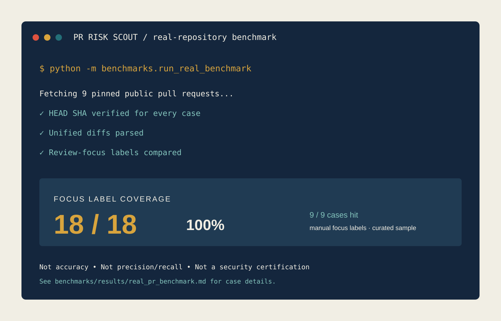

This is **not** 100% accuracy. It is not precision, recall, F1, or a security certification. The labels describe areas a reviewer was expected to inspect. They are not a complete list of all possible risks, and they do not state that the merged pull request contains a defect.

### The nine cases

| Public pull request | Changed files | Changed lines parsed | Expected review focus | Labels surfaced |
|---|---:|---:|---|---:|
| pallets/flask #6168 — Drop support for Python 3.10 | 12 | 71 | CI workflow, runtime compatibility, tests | 3 / 3 |
| psf/requests #7636 — Bump the actions group with 4 updates | 2 | 8 | CI workflow, dependencies | 2 / 2 |
| psf/requests #6767 — Revert caching a default SSLContext | 1 | 55 | TLS verification | 1 / 1 |
| pydantic/pydantic #13544 — Fast paths for pure annotations and simple defaults | 10 | 1,623 | Cache correctness, schema generation, tests | 3 / 3 |
| pydantic/pydantic #14138 — Construct builtin scalar union schemas directly | 2 | 194 | Schema generation, tests | 2 / 2 |
| pytest-dev/pytest #15309 — Bump the GitHub Actions group | 2 | 8 | CI workflow, dependencies | 2 / 2 |
| pytest-dev/pytest #15298 — Store a timing.Duration in CallInfo | 7 | 168 | Timing behaviour, tests | 2 / 2 |
| astral-sh/ruff #29961 — Handle decorators replacing overrides of final methods | 2 | 60 | Type checking | 1 / 1 |
| astral-sh/ruff #27908 — Extend __debug__ write check to attribute targets | 5 | 480 | Parser syntax, tests | 2 / 2 |

### Read an example finding

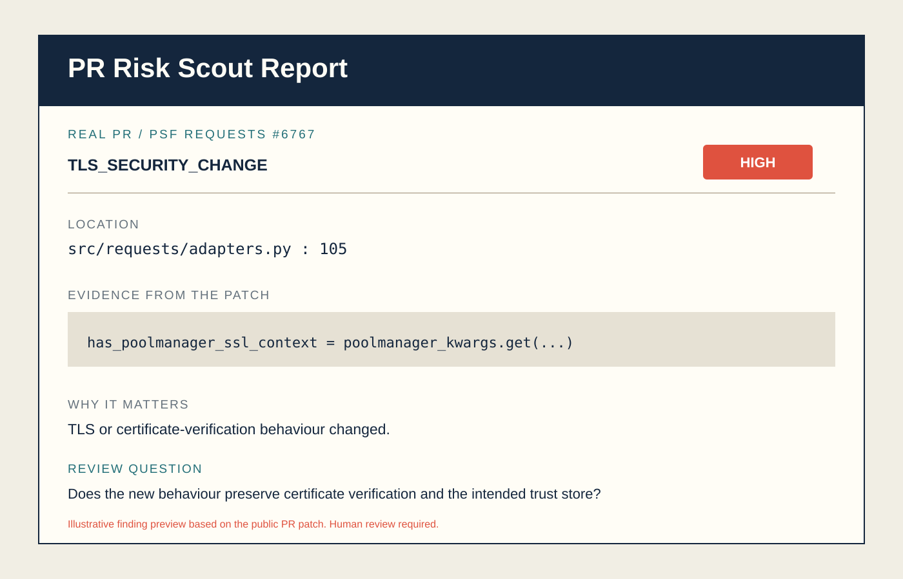

The report preview is based on the TLS-related changes in [Requests #6767](https://github.com/psf/requests/pull/6767). It shows what a useful signal should contain: a rule ID, severity, file, changed line, evidence, reason, and a question. It is an explanatory report-style screenshot, not a screenshot of a live browser interface.

### Reproduce the benchmark

~~~bash
pip install -r requirements.txt
python -m benchmarks.run_real_benchmark
~~~

The runner checks the current head SHA of each pull request against the pinned SHA in `benchmarks/real_pr_cases.json`. If a pull request has changed, the runner stops instead of quietly substituting a different version. It then downloads the public diff, runs the analyzer, compares detected categories with the expected focus labels, and writes `benchmarks/results/real_pr_benchmark.json`.

The human-readable result is in [`benchmarks/results/real_pr_benchmark.md`](benchmarks/results/real_pr_benchmark.md). The machine-readable result is in [`benchmarks/results/real_pr_benchmark.json`](benchmarks/results/real_pr_benchmark.json).

### Why no precision, recall, or F1?

To calculate those metrics honestly, we would need exhaustive ground truth. That means reviewers would have to inspect every relevant change in every sampled PR and independently decide which findings are relevant, which are harmless, and which expected issues were missed. The current focus labels are not that dataset. Calling them ground truth would overstate what was done.

The current benchmark is a small, transparent engineering case study. It proves that the harness works on selected real patches and that the current rule set can surface those chosen review areas. It does not prove how the tool performs across the GitHub ecosystem.

## Repository map

| Path | Purpose |
|---|---|
| `pr_risk_scout/parser.py` | Reads unified diffs and preserves changed-line locations. |
| `pr_risk_scout/analyzer.py` | Defines rule patterns and creates findings. |
| `pr_risk_scout/github_client.py` | Makes read-only GitHub requests. |
| `pr_risk_scout/__main__.py` | Command-line entry point and report writer. |
| `tests/test_analyzer.py` | Parser and rule tests. |
| `examples/sample.diff` | Small teaching patch. |
| `benchmarks/real_pr_cases.json` | Pinned public PR sample and expected review-focus labels. |
| `benchmarks/run_real_benchmark.py` | Reproduction script for the case study. |
| `benchmarks/results/real_pr_benchmark.json` | Machine-readable benchmark result. |
| `benchmarks/results/real_pr_benchmark.md` | Human-readable benchmark result. |
| `docs/ARCHITECTURE.md` | Component map and design choices. |
| `docs/THREAT_MODEL.md` | Assets, threats, controls, and known gaps. |
| `docs/BENCHMARK_METHOD.md` | Methodology and metric caveats. |
| `docs/STEP_BY_STEP.md` | Beginner walkthrough. |
| `docs/OPERATING_GUIDE.md` | Runbook for local and GitHub scans. |
| `docs/FAQ.md` | Common questions. |
| `assets/visuals/` | Forty original Japanese-editorial diagrams. |
| `docs/screenshots/` | Report-style visual previews for the README. |

## Understanding the codebase

### `pr_risk_scout/parser.py`

This file reads unified diff text. It tracks the old and new line numbers separately. When a line is added, the new line counter advances. When a line is removed, the old line counter advances. Context lines advance both counters. This allows a finding to point to the correct location for either an addition or a deletion.

The parser returns a list of dictionaries. Each dictionary contains `file`, `change`, `line`, and `content`. The analyzer consumes these records. That separation is important: the parser should describe what changed, while the analyzer decides what patterns deserve attention.

### `pr_risk_scout/analyzer.py`

The analyzer contains the rule definitions and the function that evaluates the parsed changes. Each rule has a stable identifier, a severity label, patterns for file paths and text, a reason, and a reviewer question. The analyzer collects findings and counts them by category.

The implementation intentionally keeps the rule definitions visible. A developer should be able to read a rule and understand what it checks. If a pattern is too broad, tighten it and add a regression test. Do not hide noisy output by silently dropping evidence.

### `pr_risk_scout/github_client.py`

The GitHub client fetches pull-request diff data using HTTP GET. It validates the repository name format and sends a user-agent and API version header. If an optional token is present in the environment, it sends it as a bearer token. It does not contain any methods for writing to GitHub.

### `pr_risk_scout/__main__.py`

The command-line interface handles arguments. It requires one input source: a local diff or a GitHub repository. GitHub mode also requires a pull-request number. It selects the output format and writes report files under the path chosen by the user.

### `tests/test_analyzer.py`

The test suite gives examples of the patterns the tool should recognise. It checks authentication, database migrations, TLS changes, dependency files, CI workflows, runtime support, caches, schema generation, timing, static type analysis, parser syntax, test surface, newly added secrets, dangerous execution, error handling, and serialization. It also checks that added and removed lines retain their direction.

### `benchmarks/`

The benchmark folder contains the pinned sample, a runner, and result files. It is intentionally separate from unit tests. Unit tests verify small pieces of software behaviour. The benchmark checks how the assembled rule set behaves on a selected group of public engineering changes.

## How to read a finding

A finding is a prompt to investigate. Consider the following fictional example:

~~~json
{
  "rule_id": "TLS_SECURITY_CHANGE",
  "severity": "high",
  "file": "src/network/client.py",
  "line": 84,
  "change": "added",
  "evidence": "verify = False",
  "why_it_matters": "TLS or certificate-verification behaviour changed.",
  "review_question": "Does the new behaviour preserve certificate verification?"
}
~~~

The word fictional matters here. This example explains the shape of a finding; it is not a report from a real pull request. When using the tool, always open the real file at the reported line and inspect the surrounding code.

A finding has five practical parts:
1. **Rule ID** tells you which detector matched.
2. **Severity** helps you prioritise which finding to inspect first.
3. **Location** lets you navigate back to the source.
4. **Evidence** shows the changed text that matched.
5. **Review question** suggests the next useful check.

If a finding cannot show a source line, the tool is not giving you enough information to make a decision. If the evidence is too broad, improve the rule and add a test.

## Read-only security model

The read-only promise is a product boundary, not a marketing phrase. The client retrieves metadata and patch text. The analyzer works on local strings. The report writer creates local files. There is no code path that approves, merges, comments, labels, or assigns the pull request.

Use a fine-grained token. Grant only the access required to read the selected repository's contents and pull requests. Do not use a personal access token with broad account-wide permissions for a small experiment when a restricted token is available.

Do not execute the pull request's code. This project needs the text of a diff, not a working checkout of the target project. Running code from an unfamiliar branch would create a different security problem and is outside this tool's purpose.

The analyzer treats patch content as input text. It does not pass code lines to a shell. Reports should be stored in an appropriate local directory and should not be committed if they contain private code or sensitive repository context.

See [the threat model](docs/THREAT_MODEL.md) for assets, trust boundaries, controls, known gaps, and safe operating guidance.

## What the benchmark taught us

The first broad pattern pass was noisy. Common words such as "execution", "session", or "serializer" appeared in contexts that were not necessarily security or behaviour changes. That was a useful engineering result: a rule that fires often is not automatically a good rule.

The rule set was tightened by using more specific paths and requiring actual content matches for several categories. The benchmark was rerun against the same public PRs. The current focus-label table records what was surfaced, while extra signals remain visible rather than being silently called false positives.

This is why the project stores the sample definition and result files. A benchmark is a feedback tool. It should help a developer discover weak rules, not create a headline number that hides weaknesses.

## Test strategy

Run the tests with:

~~~bash
python -m pytest -q
~~~

The GitHub Actions workflow runs the test suite across Python 3.10, 3.11, 3.12, and 3.13. It separately runs the public-PR benchmark and uploads the JSON report as a workflow artifact.

A good test suite should cover:
- Correct line numbers for additions and deletions.
- Multiple hunks and multiple files.
- Each rule's expected positive example.
- Cases where a similar word should not trigger a finding.
- The difference between a newly added secret and a removed secret.
- Report fields and evidence formatting.
- Empty diffs and malformed input boundaries.
- Read-only GitHub behaviour.

When adding a new rule, add at least one positive test and one boundary test. When changing the parser, rerun the full suite because parser mistakes can affect every rule.

## Step-by-step learning exercises

### Exercise A — Add a rule for shell pipelines

Start by writing down the exact behaviour you want to detect. Decide whether you want to look at a path, a changed line, or both. Add a rule with a stable ID, severity, explanation, and reviewer question. Write a small patch fixture that should match it. Then write another patch that contains similar words but should not match. Run the test suite before and after.

### Exercise B — Add an allow-list

Some repositories intentionally maintain a generated or vendored file that triggers a rule repeatedly. Do not simply delete the rule. Consider a repository-specific allow-list that is explicit, reviewed, and visible in the configuration. Add tests showing that an allowed path is suppressed and a similar unlisted path still produces a finding.

### Exercise C — Add SARIF output

SARIF is a structured format often used to exchange static-analysis findings. Map each finding into a SARIF result with a rule ID, message, severity, and physical location. Keep the Markdown and JSON output working. Add a schema validation test. The output must not claim a certainty level the rule does not possess.

### Exercise D — Add a human-adjudication file

A future benchmark should allow reviewers to label each finding as useful, harmless, or unclear. Create a CSV or JSON format that records the PR URL, rule ID, file, line, evidence, reviewer label, and reason. Do not mix those labels with the current focus-area labels; they answer different questions.

### Exercise E — Add a second language

Start with one language and one narrow rule family. For example, identify dependency file changes in a JavaScript project or SQL migration files in a backend repository. Add real fixtures and tests before claiming support. A list of file extensions alone is not language understanding.

## Troubleshooting

### Python cannot find the package

Run commands from the project root. Check that the virtual environment is active. If the import still fails, use the environment's Python executable directly and confirm that the folder `pr_risk_scout` exists beside `README.md`.

### The GitHub request returns 404

Check the repository name, pull-request number, and whether the repository is accessible to the token. A 404 can mean that the resource does not exist or that a private resource is not visible to the caller.

### The GitHub request returns 401

The token may be invalid, expired, revoked, malformed, or unavailable in the shell where the command runs. Create a new restricted token if necessary. Never paste the token into an issue or a chat.

### The GitHub request returns 403 or 429

You may have hit an API permission or rate limit. Public repository requests without a token are rate-limited. Reduce repeated requests, wait for the reset time, or use a correctly scoped read-only token. Do not add a retry loop that repeatedly hammers the API.

### A finding points to the wrong line

Inspect the original patch's hunk headers. Add a parser test that reproduces the exact structure. Check how the parser handles context lines, additions, deletions, and file boundaries. Never fix a line-number bug by adjusting output after the fact.

### A rule flags too many harmless changes

Inspect the evidence in the actual reports. Narrow the regex, tighten the path condition, or require an added-only match where appropriate. Add a regression test using the harmless example. Rerun unit tests and the benchmark after changing a rule.

### A rule misses a meaningful change

Save the public patch as a fixture or add a minimal example. Write a failing test first. Decide whether the issue needs a new rule or whether an existing rule is too narrow. Keep the distinction visible in the rule ID and documentation.

### The benchmark stops because a SHA changed

That is intentional. A pinned sample must not quietly change its input. Inspect the pull request, decide whether the new version should replace the old case, update the metadata deliberately, and explain the change in the benchmark notes.

## Glossary for beginners

- **API:** A defined way for one program to communicate with another.
- **Base branch:** The branch a pull request proposes to change.
- **Bearer token:** A secret value that grants access to an API when sent in a request header.
- **Benchmark:** A repeatable exercise used to observe how a tool behaves on known inputs.
- **CI:** Continuous integration; automated checks that run when code changes.
- **Commit:** A saved snapshot of changes in Git.
- **Dependency:** A package or tool that a project relies on.
- **Diff:** A text representation of lines added, removed, or kept as context.
- **Evidence:** The exact source change that explains why a rule fired.
- **False positive:** A warning that appears but is not relevant to the situation being reviewed.
- **Fine-grained token:** A credential restricted to selected repositories and specific permissions.
- **Git:** A version-control system that records changes to files over time.
- **GitHub API:** An HTTP interface for reading or changing GitHub resources.
- **Head commit:** The latest commit on the pull-request branch being evaluated.
- **Hunk:** A section of a diff that groups nearby changes.
- **Lockfile:** A file recording resolved dependency versions.
- **Merge:** Combining a proposed change into the target branch.
- **Monotonic clock:** A clock intended for measuring elapsed time without moving backwards.
- **OpenAPI:** A common machine-readable description of HTTP APIs.
- **Patch:** Another name for a diff that can be applied to source files.
- **Pull request:** A proposal to merge changes from one branch into another.
- **Read-only:** An access mode that allows reading but not modifying the remote resource.
- **Rule:** A check that looks for a defined pattern in changed code.
- **SARIF:** A structured format for exchanging static-analysis results.
- **Severity:** A priority label that helps order review work.
- **TLS:** Transport Layer Security, used to protect network connections.
- **Transitive dependency:** A package required by another package your project uses.
- **Unified diff:** A common patch format that records old and new line ranges.
- **False negative:** A relevant issue that the tool does not flag.
- **Review-focus label:** A human-selected category that describes what area a reviewer should inspect.
- **Ground truth:** A reliable set of labels established through an explicit, repeatable review process.

## FAQ

### Is this an AI agent?

The current core is a rule-based pull-request review assistant. It is part of the 200 AI Agents learning challenge, but it does not call an LLM yet. This is deliberate: the behaviour is inspectable, and the benchmark can evaluate the rule layer without a generative model hiding the reason for a result.

### Does a 100% benchmark score mean it is accurate?

No. The 100% figure means 18 of 18 manually selected focus labels were surfaced in nine selected PR examples. It does not mean 100% of findings are correct or that every risk in the PRs was found.

### Does it replace a developer?

No. It is an extra review aid. The developer remains responsible for reading the code and making the decision.

### Can it scan any language?

It can parse unified diffs regardless of language, but the rules are not universal. Several rules are focused on Python repositories and common configuration files. Other languages need their own carefully tested rule packs.

### Does it upload code somewhere?

The GitHub mode reads public or authorised PR diffs through the GitHub API. Local diff mode reads a file on your computer. The analyzer does not execute the code. The report is written to the output path you choose.

### Why use deterministic rules before an LLM?

It creates a transparent baseline. You can see the exact pattern, test the behaviour, and observe where it is noisy. A future LLM could explain findings in simpler language, but the evidence and rule logic should remain visible.

## Roadmap

1. Tighten existing rules using independent human adjudication.
2. Add configurable rule packs for different teams.
3. Add SARIF export.
4. Improve multi-language path and content rules.
5. Add richer parsing for renames, binary files, and unusual patch metadata.
6. Add larger, randomly sampled benchmark sets.
7. Add reviewer agreement measurement and confidence intervals.
8. Consider an optional LLM explanation layer that cites only supplied evidence.
9. Keep the core read-only by default.

## Contributing

Open an issue that explains the review problem you want to detect. Include a minimal diff that should trigger the rule and a similar diff that should not. A good rule contribution includes a clear ID, severity rationale, path and text patterns, positive and boundary tests, and a plain-language reviewer question.

Do not include secrets, private source code, or confidential customer details in public issues. Use fabricated fixtures when a real example cannot be shared.

## License

MIT. See [LICENSE](LICENSE).

---

**Build small. Preserve evidence. Test the edge cases. Keep a human in the loop.**

*200 AI Agents in 200 Days · Agent #6*

## Twenty realistic review scenarios

These scenarios are not a test dataset. They are practical examples to help a developer understand what a finding should make them ask. Each scenario also shows why context matters: the same pattern can be harmless in one project and risky in another.

### Scenario 01 — A permission check is removed

The reviewer should inspect the function around the removed line, trace the caller, and check which roles can reach it. A removed check is not automatically a vulnerability: perhaps the check moved to middleware or a shared helper. The report should start the investigation, not decide its outcome.

### Scenario 02 — A migration drops a column

The reviewer should check whether the column still contains valuable data, whether code reads it during a rolling deployment, whether backups exist, and whether rollback can restore the old schema. A safe migration often needs more than one release step. The rule cannot know the production deployment sequence.

### Scenario 03 — A TLS verification option changes

The reviewer should check the effective configuration for default and custom certificate bundles. A change may be a performance optimisation or a security regression depending on the surrounding implementation. Verify the actual behaviour in tests and documentation rather than assuming that a single variable name tells the whole story.

### Scenario 04 — A package lockfile is updated

Compare the resolved dependency graph, not just the top-level package version. Check whether the update adds or removes transitive packages, changes a platform-specific dependency, or introduces a new license or build step. The tool can show that a dependency file changed; a package audit must do the deeper work.

### Scenario 05 — A GitHub Action version changes

Check whether the action is pinned to a full commit SHA, whether that SHA corresponds to the claimed version, and what permissions the workflow has. Also inspect the triggering events. A trusted action running with write permission on an untrusted pull request can be more consequential than the version number itself.

### Scenario 06 — The supported Python version changes

Check package metadata, setup files, documentation, CI matrix entries, classifiers, and syntax used by the implementation. If Python 3.10 support is dropped, a code path that imports a 3.11-only standard-library module may be correct, but it must be consistent across every place the project declares support.

### Scenario 07 — A cache is introduced

Ask what is included in the cache key, whether values are mutable, how invalidation works, and whether a value is safe to share across threads or users. A cache can be technically correct in a small test yet leak stale configuration in a long-running process.

### Scenario 08 — A schema cache is optimised

Check which schema inputs are considered safe to reuse, whether custom hooks are excluded, and whether copied objects can still share mutable state. Schema generation is often subtle because annotations, defaults, type variables, and model configuration can interact.

### Scenario 09 — Timing code is refactored

Check how the code behaves when wall-clock time is mocked, when monotonic time is mocked, when the process pauses, and when a test result has no measurable duration. Timing APIs often have many callers, so preserve compatibility for plugins and reporting code.

### Scenario 10 — A decorator changes a method

A decorator may return a different function and bind that returned function to the original method name. A type checker or autofix must not assume that the function defined in the subclass is always the function now stored under that name. Inspect both the declaration and the result of the decorator.

### Scenario 11 — A parser adds a syntax rule

Check the target language version and syntactic context. A form may be legal in one version and illegal in another. Add fixtures for the exact syntax and snapshot expected diagnostics. Parser state bugs often appear in nested constructs or when a node is visited in more than one context.

### Scenario 12 — A test is removed

Find out whether the behaviour is no longer supported, the test was moved, or coverage was accidentally lost. Search the surrounding test folder and the change description. The tool can flag that a test surface changed, but it cannot decide whether the deleted test was obsolete.

### Scenario 13 — An endpoint response field changes

Check whether clients depend on the field, whether the field is required, whether the new type is compatible, and whether the API is versioned. A backwards-compatible API change should be assessed from the consumer's point of view, not only from the server implementation.

### Scenario 14 — An exception type changes

Callers may catch a specific exception or rely on a fallback. A new exception group or wrapper exception may be more expressive, but it can change caller behaviour. Look at tests and public documentation for the expected contract.

### Scenario 15 — A deserializer is changed

Check whether the input is trusted, whether the format allows object construction, whether old serialized data still loads, and whether errors are safe to expose. A format that is convenient for internal state may be unsafe for user-supplied files.

### Scenario 16 — A generated file changes

Determine whether the generated file should be edited manually or regenerated from a source definition. Check the generator version and whether the generated output matches the source. A large diff may be ordinary output from a tool rather than an intentional hand-written change.

### Scenario 17 — A documentation example changes

Documentation is not executable code, but users copy examples. Check whether command names, version numbers, defaults, and safety notes still match the implementation. A docs-only change can therefore deserve review, even if it does not change runtime behaviour.

### Scenario 18 — A new environment variable is added

Check whether the variable has a safe default, whether secrets could be logged, and whether it is documented. Also check what happens when it is missing, empty, malformed, or set to an unexpected value.

### Scenario 19 — A command gains shell execution

Look at how arguments are constructed and whether input can contain shell metacharacters. Prefer argument arrays and direct subprocess APIs rather than assembling a string passed through a shell. The presence of shell execution is a prompt to inspect the data path.

### Scenario 20 — An API client adds retries

Check which errors are retryable, whether the operation is idempotent, whether backoff is bounded, and whether rate-limit headers are respected. Retrying a non-idempotent write can create duplicates. This project itself avoids automatic retry storms and keeps its remote requests read-only.

## Further study plan

A beginner can use the repository as a four-week study exercise.

### Week 1 — Git and patches

Learn the difference between a working tree, a commit, a branch, and a pull request. Read a small diff manually. Identify the hunk header, added lines, removed lines, and context. Then run the sample scan and compare the parser output with the actual patch. The goal is to understand how source changes become structured records.

### Week 2 — Python structure and regular expressions

Read the parser and analyzer line by line. Change one small rule. Write a test that proves it matches the intended patch, then write a second test that proves it does not match a harmless lookalike. Run the tests after each change. The goal is not to memorise every regular expression; it is to learn how to define and verify a small behaviour.

### Week 3 — HTTP and GitHub API

Run a public PR scan. Inspect the request URL and response type. Learn what GET means, what a bearer token is, and why permissions should be restricted. Read the HTTP status code when something fails. The goal is to understand the boundary between a local Python program and a remote service.

### Week 4 — Evaluation and technical writing

Read the benchmark manifest, result file, and limitations. Pick one case and inspect the real public PR manually. Decide whether the expected focus label makes sense. Review any additional signals. Then write a short note explaining what the tool caught and what it missed. The goal is to communicate results without overstating them.

### Optional extension — Learn a Japanese engineering vocabulary

The diagrams use a small set of Japanese editorial marks. 設計 means design. 検証 means verification or validation. 安全 means safety. 解析 means analysis. 記録 means record or log. These words are used as visual signposts, not as a substitute for the English technical explanation. The visual direction is inspired by clean technical documentation and engineering field notes: strict alignment, restrained colour, clear hierarchy, and no decorative clutter that hides the information.

